# Awesome-Enterprise-Collaboration-Secure-Messaging


  





  
  
  
  
  



# 🔐 Top Enterprise Collaboration & Secure Messaging

**Curated List of SaaS/Commercial Platforms & Open-Source GitHub Projects**  
*Focused on End-to-End Encrypted (E2EE) Team Chat, Federated Matrix Servers, Sovereign Self-Hosted Workspaces, Air-Gapped Messaging & Video Conferencing*  
**Last updated: November 2026**

This repository tracks notable **SaaS/Commercial platforms** and **open-source projects** for **Enterprise Collaboration & Secure Messaging**. These tools power sovereign self-hosted team messaging, end-to-end encrypted (E2EE / MLS) communications, federated Matrix protocol servers, defense/government air-gapped collaboration, encrypted video conferencing, and secure file sharing for enterprise IT teams, security engineers, and privacy-conscious organizations.

**Examples** include Microsoft Teams, Slack Enterprise (Salesforce), Cisco Webex, AWS Wickr (Amazon), Keybase (Zoom), Symphony, Mattermost (Cloud/Enterprise), Rocket.Chat (Cloud/Enterprise), Element (Matrix Cloud), and Wire (the category leaders).

**🚀 Open-source emphasis**: This section is heavily expanded with every major active project for self-hosted team chat (`Mattermost`, `Rocket.Chat`, `Zulip`), federated Matrix homeservers & clients (`Synapse`, `Dendrite`, `Conduwuit`, `Element`), E2EE messaging (`Wire`, `Signal`, `Session`, `SimpleX Chat`), and encrypted video/collaboration (`Jitsi Meet`, `Nextcloud Talk`, `BigBlueButton`, `CryptPad`) — ideal for organizations requiring full data sovereignty, GDPR/HIPAA/defense compliance, and zero per-seat SaaS lock-in.

🤝 Contributions welcome! Open a PR to add/update entries. Keep descriptions factual and link to official sites.

## 📑 Table of Contents
- [📊 Sector Overview & Market Dynamics](#-sector-overview--market-dynamics)
- [☁️ SaaS/Hosted & Commercial Platforms](#️-saashosted--commercial-platforms)
- [💻 Open-Source GitHub Projects](#-open-source-github-projects)
- [🛠️ How to Contribute](#️-how-to-contribute)
- [⚠️ Disclaimer](#️-disclaimer)
- [💖 Support & Thank You](#-support--thank-you)

## 📊 Sector Overview & Market Dynamics

The global Enterprise Collaboration & Team Messaging market is valued at approximately **$58B–$68B+ in 2026** (with specialized sovereign, regulated, and E2EE secure enterprise messaging accounting for **$8B–$11B**), expanding at a ~12%–15% CAGR driven by data-sovereignty laws, zero-trust security mandates, and IETF Messaging Layer Security (MLS) adoption. The mainstream corporate cloud market exhibits **strong winner-take-most consolidation** around Microsoft Teams, Slack, and Cisco Webex, whereas defense, public-sector, and privacy-first enterprises are increasingly consolidating around **open-source, self-hosted, and federated standards** like Matrix (`Element`), `Mattermost`, `Zulip`, and `Rocket.Chat`.

## ☁️ SaaS/Hosted & Commercial Platforms

*Sorted descending by company valuation / annual revenue scale.*

| Platform | Description | Company Scale (Valuation / Revenue) | Starting Paid Tier | Free Tier / Trial Limit |
| :--- | :--- | :--- | :--- | :--- |
| **[Microsoft Teams](https://microsoft.com)** | Enterprise cloud collaboration hub combining persistent chat, video meetings, phone systems, and Microsoft 365 Copilot integration. | **Part of Microsoft Corp.** (~$245B+ annual revenue; ~$3T+ market cap) | **$4.00 / user / month** billed annually (Teams Essentials) or **$6.00 / user / mo** (M365 Business Basic) | **Forever Free Plan** (Unlimited 1:1 messages, group meetings up to **60 minutes & 100 participants**, and 5 GB cloud storage) |
| **[Slack Enterprise (Salesforce)](https://slack.com)** | Channel-based enterprise messaging, workflow automation, and AI search platform built for distributed teams and external Slack Connect partners. | **Part of Salesforce** (Acquired for $27.7B; ~$38B+ Salesforce annual revenue) | **$7.25 / user / month** billed annually ($8.75/mo monthly for Pro; Enterprise Grid custom) | **Forever Free Plan** (Unlimited users & channels with **90-day message/file history visibility**, 1:1 Huddles, and up to 10 app integrations) |
| **[AWS Wickr (Wickr Enterprise)](https://amazon.com)** | End-to-end encrypted, ephemeral enterprise and defense messaging, voice/video calling, and compliance archiving service on AWS. | **Part of Amazon / AWS** (~$115B+ AWS annual revenue; ~$2T+ parent market cap) | **$4.99 / user / month** (Wickr Standard) or **$9.99 / user / month** (Wickr Enterprise) | **30-Day Free Trial** (Full Wickr Enterprise trial with E2EE messaging, ephemeral timers, and compliance logging; no perpetual free tier) |
| **[Cisco Webex](https://webex.com)** | Enterprise unified communications, end-to-end encrypted team messaging, cloud calling, and AI-powered video conferencing suite. | **Part of Cisco Systems** (~$54B+ annual revenue; ~$220B+ market cap) | **$12.00 / user / month** billed annually ($14.50/mo monthly for Webex Meet/Suite Starter) | **Forever Free Plan** (Unlimited 1:1 & team messaging, meetings up to **40 minutes & 100 participants**, and local recordings) |
| **[Keybase (Zoom)](https://keybase.io)** | Cryptographically verified, end-to-end encrypted team chat, Git repositories, and file-sharing platform backed by public-key identity proofs. | **Part of Zoom Communications** (~$4.7B+ Zoom annual revenue; ~$20B+ market cap) | **$0 / Free Consumer & Team Tier** (Core encryption tech integrated into Zoom E2EE) | **100% Free Forever** (Unlimited E2EE team chats, encrypted Git repos, and **250 GB encrypted cloud file storage** per user) |
| **[Symphony](https://symphony.com)** | Regulated, end-to-end encrypted messaging and federation platform engineered specifically for global banks, capital markets, and financial compliance. | **~$1.4B+ Valuation** (~$100M+ est. ARR; backed by major Wall Street consortia) | **~$20 – $30 / user / month** indicative institutional financial seat pricing (minimum seat commitments) | **Guided Enterprise Demo / Sandbox** (No public self-serve free tier; institutional compliance pilot available on request) |
| **[Mattermost (Cloud / Enterprise)](https://mattermost.com)** | Mission-critical, air-gapped-ready collaboration platform for defense, government, and DevSecOps teams featuring incident playbooks and RBAC. | **~$300M–$500M Est. Valuation** (~$40M–$60M est. ARR; $70M+ VC funding) | **$10 / user / month** billed annually for Professional (Enterprise custom quotes) | **Forever Free Self-Hosted Entry / 30-Day Cloud Trial** (Self-hosted Mattermost Team Edition is **100% free forever** for unlimited users) |
| **[Rocket.Chat (Cloud / Enterprise)](https://rocket.chat)** | Omnichannel, sovereign team communication platform offering E2EE messaging, air-gapped deployment, and Matrix federation. | **~$100M–$150M Est. Valuation** (~$20M+ est. ARR; $27M+ VC funding) | **$7 / user / month** billed annually for Pro (minimum 25 users; Enterprise custom) | **Forever Free Community Plan** (Free self-hosted Community workspace supporting **up to 50 active users** with core messaging & E2EE) |
| **[Element (Matrix Cloud / EMS)](https://element.io)** | Flagship commercial Matrix hosting, sovereign defense messaging, and cross-platform E2EE collaboration suite built on the open Matrix protocol. | **~$50M–$100M Est. Valuation** (~$15M+ est. ARR; $40M+ VC funding) | **$5 / user / month** for Element Matrix Services (EMS) starter hosting (Enterprise custom) | **Forever Free Public Matrix Account** (Unlimited free E2EE messaging/calls on `matrix.org` or self-hosted Element Web/Desktop/Mobile clients) |
| **[Wire](https://wire.com)** | European-headquartered, zero-knowledge end-to-end encrypted enterprise collaboration suite implementing the IETF Messaging Layer Security (MLS) standard. | **~$50M–$80M Est. Valuation** (~$10M–$15M est. ARR; backed by UVC/Moravia) | **€7.65 / user / month** (~$8.25/mo) billed annually for Wire Enterprise | **Forever Free Personal Tier / 14-Day Enterprise Trial** (Free E2EE messaging & calls for personal accounts; 14-day full Enterprise trial) |

## 💻 Open-Source GitHub Projects

| Project | License / Hosting Cost | Free Tier / Self-Hosted Limit | Description |
| :--- | :--- | :--- | :--- |
| **[Mattermost (`mattermost/mattermost`)](https://github.com)** | **MIT / AGPL / Source-Available** ($0 self-hosted Team Edition) | **100% Free forever** self-hosted (Unlimited users, channels, message history, webhooks, and mobile/desktop apps on your server) | The leading open-source, self-hosted Slack alternative built for high-security engineering, DevSecOps, and sovereign enterprise teams. |
